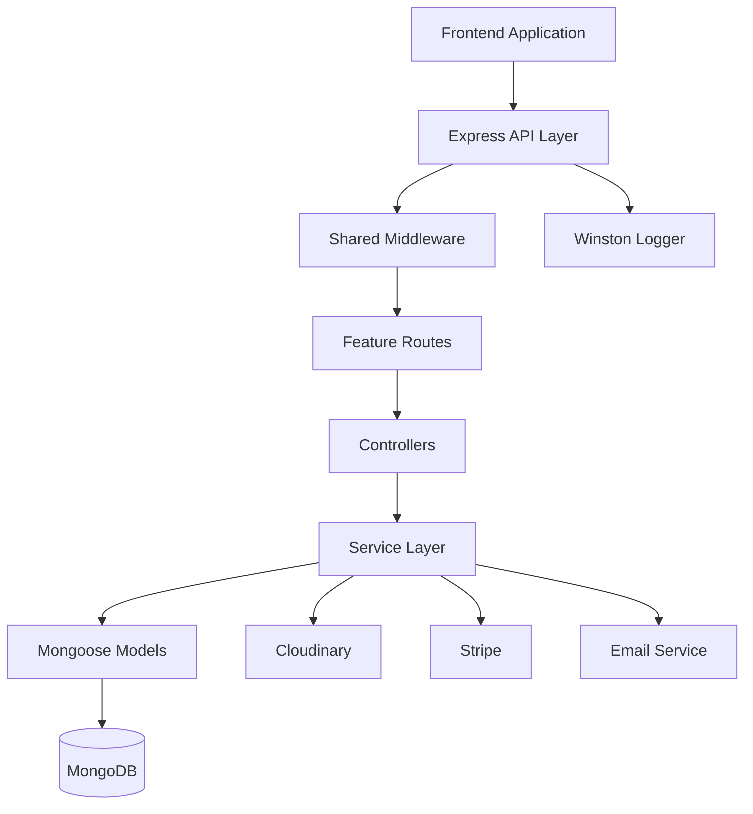
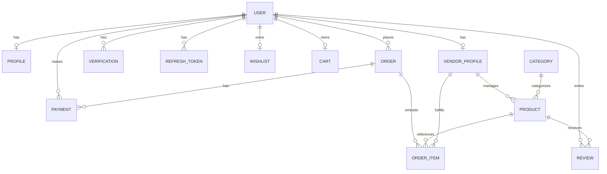
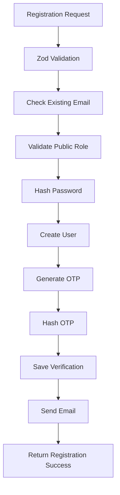
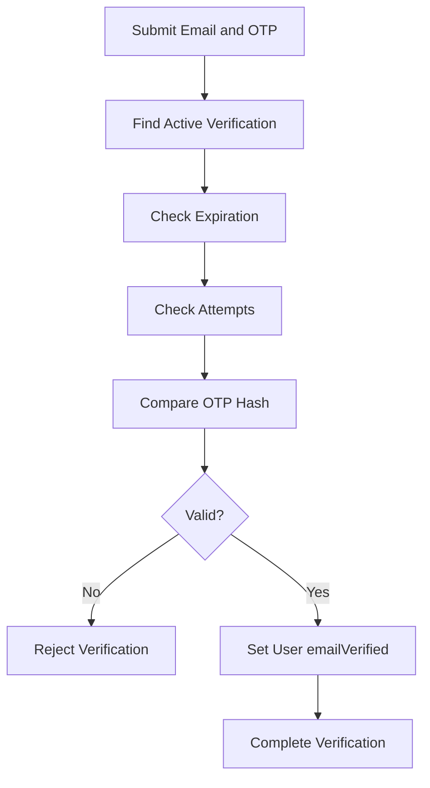
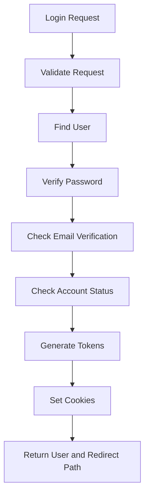
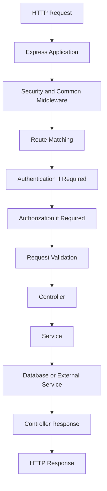
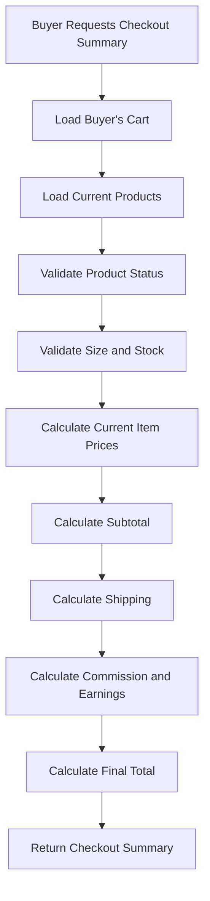
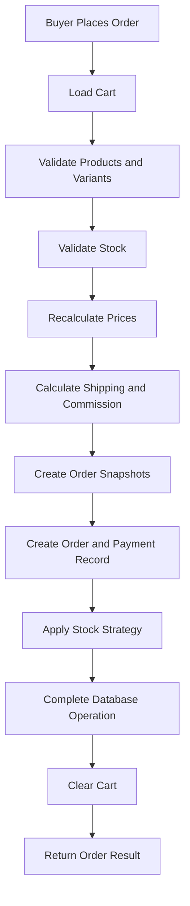
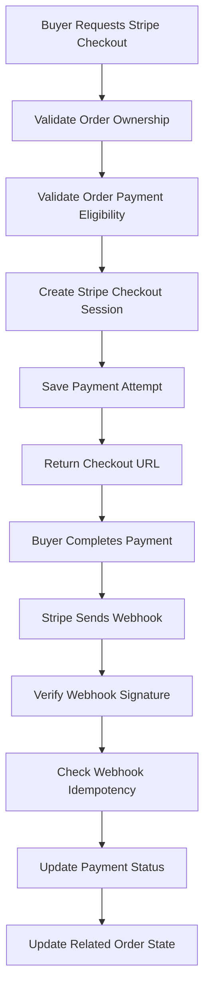
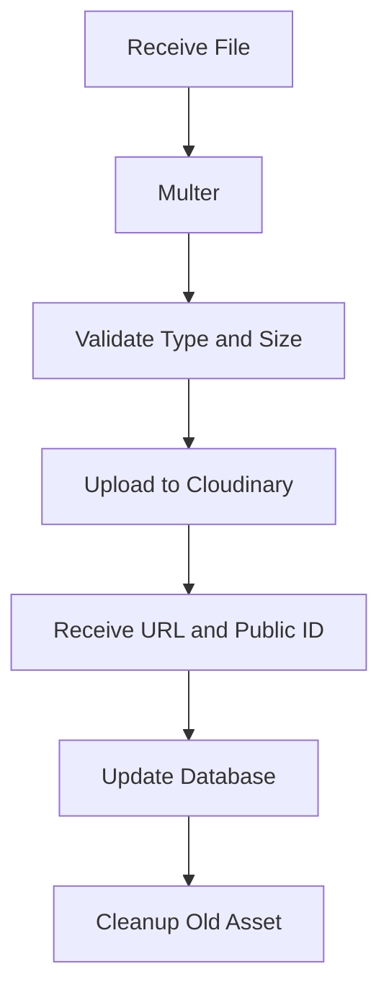

# Jus Buy — Architecture Context

**Purpose:** Define the technical architecture, backend structure, module boundaries, database relationships, data flows, security boundaries, and architectural decisions of Jus Buy.

**Document Role:** This document is the primary technical architecture reference for the Jus Buy backend.

All backend implementation must follow:

- `project-overview.md` — Product requirements and business rules
- `project-architecture.md` — Technical architecture and system design
- `code-standards.md` — Coding conventions and implementation standards
- `ai-workflow-rules.md` — AI development workflow
- `progress-tracker.md` — Development progress and current phase

---

## 1. Architecture Overview

### 1.1 System Architecture

Jus Buy follows a Modular Backend Architecture (Modular Pattern).

The backend is organized into independent feature modules. Each module owns its business logic, validation, database models, and API responsibilities.

The architecture must support:

- Clear separation of responsibilities.
- Independent feature development.
- Reusable shared infrastructure.
- Controlled dependencies between modules.
- Secure role-based and ownership-based access.
- Consistent financial calculations.
- Maintainable and testable business logic.

### 1.2 Technology Stack

| Layer               | Technology       |
| ------------------- | ---------------- |
| Runtime             | Node.js          |
| Framework           | Express.js       |
| Language            | TypeScript       |
| Database            | MongoDB          |
| ODM                 | Mongoose         |
| Validation          | Zod              |
| Authentication      | JWT              |
| File Storage        | Cloudinary       |
| Payment Gateway     | Stripe           |
| Alternative Payment | Cash on Delivery |
| Logging             | Winston          |
| API Prefix          | `/api/v1`        |

The installed package versions are the source of truth. Before using any framework or library API, inspect the installed version and its relevant documentation.

### 1.3 High-Level Architecture



The Service Layer is responsible for business operations and coordinates database access and external integrations.

Controllers must not contain business or database logic.

---

## 2. Backend Module Architecture

### 2.1 Module Organization

Each feature must be implemented as an independent module.

A feature module should separate responsibilities into:

- Model
- Interface
- Validation
- Service
- Controller
- Route

Shared functionality belongs in the shared infrastructure layer.

### 2.2 Recommended Backend Folder Structure

```text
├── src
│   ├── config
│   │   └── index.ts
│   ├── lib
│   │   ├── corsOptions.ts
│   │   ├── db.ts
│   │   ├── expressRateLimit.ts
│   │   ├── nodemailer.ts
│   │   ├── redis.ts
│   │   └── winston.ts
│   ├── middlewares
│   │   ├── globalErrorHandler.ts
│   │   └── notFoundRoute.ts
│   ├── modules
│   │   └── v1
│   ├── routes
│   │   └── v1
│   │       └── index.ts
│   ├── utils
│   │   ├── AppError.ts
│   │   ├── ERROR_CODES.ts
│   │   ├── MESSAGE.ts
│   │   ├── asyncHandler.ts
│   │   ├── jwt.ts
│   │   └── sendResponse.ts
│   ├── app.ts
│   └── server.ts
├── .prettierignore
├── .prettierrc
├── AGENTS.md
├── nodemon.json
├── package-lock.json
├── package.json
└── tsconfig.json
```

This is the recommended logical structure. Existing repository conventions must be inspected before introducing or moving folders.

Do not create duplicate modules or shared utilities when an appropriate implementation already exists.

### 2.3 Standard Feature Module Structure

Example:

```text
modules/
└── product/
    ├── product.model.ts
    ├── product.interface.ts
    ├── product.validation.ts
    ├── product.service.ts
    ├── product.controller.ts
    └── product.route.ts
```

A module may contain additional files when its complexity requires them, but the standard responsibilities must remain clear.

---

## 3. Layer Responsibilities

### 3.1 Model Layer

Responsibilities:

- Define Mongoose schemas.
- Define collection structure.
- Define field types and enums.
- Define indexes and references.
- Define schema-level validation and defaults.
- Maintain database-level invariants where appropriate.

Models must not contain HTTP request or response responsibilities.

### 3.2 Interface Layer

Responsibilities:

- Define TypeScript interfaces.
- Define request and response types.
- Define model-related types.
- Define reusable module-specific types.
- Define typed service input and output structures.
- Avoid unnecessary duplication of types.

### 3.3 Validation Layer

Responsibilities:

- Define Zod schemas.
- Validate request body.
- Validate query parameters.
- Validate route parameters.
- Validate module-specific input.

Validation must happen before business logic executes.

### 3.4 Service Layer

Responsibilities:

- Implement business logic.
- Access and coordinate database models.
- Validate resource ownership.
- Enforce business rules.
- Calculate financial values.
- Coordinate transactions.
- Handle external integrations.
- Return appropriate service results.

Business logic belongs in this layer.

### 3.5 Controller Layer

Responsibilities:

- Receive validated request data.
- Read authenticated user information.
- Call the appropriate service.
- Return consistent API responses.
- Set appropriate HTTP status codes.

Controllers must not:

- Perform complex database operations.
- Implement business rules.
- Calculate commissions or order totals.
- Handle direct payment business logic.
- Duplicate service responsibilities.

### 3.6 Route Layer

Responsibilities:

- Define HTTP methods and endpoints.
- Attach authentication middleware.
- Attach authorization middleware.
- Attach approved-vendor middleware where required.
- Attach request validation middleware.
- Connect routes to controllers.

Routes must remain thin and readable.

---

## 4. Module Boundaries and Responsibilities

| Module           | Main Responsibility                                |
| ---------------- | -------------------------------------------------- |
| User             | Common account management                          |
| Auth             | Registration, login, logout, password management   |
| Verification     | Email OTP and password reset verification          |
| Refresh Token    | Server-side refresh session management, if enabled |
| Profile          | Buyer personal information                         |
| Vendor Profile   | Vendor shop and verification information           |
| Admin Profile    | Admin account information                          |
| Category         | Admin-controlled product categories                |
| Product          | Product creation and management                    |
| Marketplace      | Public home and product discovery                  |
| Shop             | Public vendor shop information                     |
| Wishlist         | Buyer wishlist                                     |
| Cart             | Buyer shopping cart                                |
| Checkout         | Cart validation and order summary                  |
| Order            | Order creation and lifecycle management            |
| Payment          | Stripe and COD payment processing                  |
| Review           | Product ratings and reviews                        |
| Buyer Dashboard  | Buyer activity overview                            |
| Vendor Dashboard | Vendor business overview                           |
| Admin Dashboard  | Platform-wide overview                             |
| Earnings         | Vendor earnings and platform commission            |

### 4.1 Cross-Module Dependency Rules

- Modules must not duplicate another module's business logic.
- Shared functionality must be implemented in reusable infrastructure or an appropriate shared service.
- A module should access another module through clearly defined service or model boundaries.
- Avoid circular dependencies.
- Payment processing must not be duplicated inside Order and Payment modules.
- Product ownership and vendor approval checks must use the same authoritative data.
- Dashboard modules must read business data without becoming owners of the underlying business logic.

---

## 5. Database Architecture

### 5.1 Core Database Models

| No. | Model         | Collection     | Responsibility                        |
| --- | ------------- | -------------- | ------------------------------------- |
| 1   | User          | users          | Common account                        |
| 2   | Verification  | verifications  | OTP and password reset verification   |
| 3   | RefreshToken  | refreshtokens  | Optional server-side refresh sessions |
| 4   | Profile       | profiles       | Buyer personal information            |
| 5   | VendorProfile | vendorprofiles | Vendor shop and verification          |
| 6   | Category      | categories     | Product categories                    |
| 7   | Product       | products       | Product information                   |
| 8   | Wishlist      | wishlists      | Buyer wishlist                        |
| 9   | Cart          | carts          | Buyer shopping cart                   |
| 10  | Order         | orders         | Orders and embedded order items       |
| 11  | Payment       | payments       | Payment attempts and payment records  |
| 12  | Review        | reviews        | Product ratings and reviews           |

### 5.2 Models Outside Current Scope

Do not create these models without explicit approval:

| Model        | Reason                                                           |
| ------------ | ---------------------------------------------------------------- |
| Buyer        | Common User Model handles buyer accounts                         |
| Vendor       | Common User Model handles vendor accounts                        |
| Admin        | Common User Model handles admin accounts                         |
| Commission   | Commission snapshots belong in Order items                       |
| Banner       | Dynamic banner management is excluded                            |
| Notification | Notification system is excluded                                  |
| OrderItem    | Order items are embedded in Order                                |
| Payout       | Vendor withdrawal and payout are excluded                        |
| Checkout     | Checkout is a process, not a separate model in the current scope |

### 5.3 Database Relationship Overview



ORDER_ITEM in this diagram represents an embedded subdocument inside Order, not a separate MongoDB collection or Mongoose model.

### 5.4 Important Reference Decisions

#### User and Profile

- Profile.user references User._id.
- VendorProfile.vendor references User._id.
- Each Buyer has at most one Profile.
- Each Vendor has at most one VendorProfile.
- Admin does not require a separate profile model in the current scope.

#### Product and Vendor

The Product model contains a vendor reference to the corresponding VendorProfile.

The relationship is:

```text
User._id
   |
   └── VendorProfile.vendor

VendorProfile._id
   |
   └── Product.vendor
```

Important:

- Vendor-facing API ownership is based on the authenticated User._id.
- Resolve the vendor's VendorProfile using that User ID.
- Product ownership is validated against the corresponding VendorProfile.
- Public shop routes use the Common User Model ID as vendorId, according to the API requirements.
- Do not confuse User._id with VendorProfile._id.

#### Order and Order Items

- Order.buyer references User._id.
- Each embedded order item references its Product.
- Each embedded order item identifies its Vendor.
- Each order item stores historical product and financial snapshots.
- Order items are not stored in a separate collection.

#### Payment and Order

- Payment.order references Order._id.
- Payment.buyer references User._id.
- An order may have multiple payment attempts.
- A unique index on Payment.order must not prevent multiple attempts.

---

## 6. Authentication Architecture

### 6.1 Common Authentication System

All account roles use one authentication system.

```text
BUYER
VENDOR
ADMIN
  |
  v
Common User Model
  |
  v
Common Authentication Module
```

No separate Buyer, Vendor, or Admin authentication system is allowed.

### 6.2 Registration Flow



Rules:

- Only BUYER and VENDOR can register publicly.
- ADMIN registration must be rejected.
- Email must be unique.
- Password must be hashed.
- emailVerified defaults to false.
- No access or refresh token is issued during registration.
- Buyer Profile and Vendor Shop setup happen separately.

### 6.3 Email Verification Flow



Security requirements:

- Store OTP as a hash.
- Never store plaintext OTP.
- Enforce expiration.
- Enforce failed-attempt limits.
- Enforce resend rate limits.
- Invalidate previous active OTP when resending.
- Prevent successful OTP reuse.

### 6.4 Login Flow



Login must not depend on vendor shop approval.

Vendor shop approval is checked only for selling-related operations.

### 6.5 Password Management

Authentication owns:

- Forgot password.
- Reset password.
- Change password.
- Password hashing.
- Reset verification.
- Related refresh session invalidation.

Password reset responses must not reveal whether an email address belongs to an account.

### 6.6 Current Profile API Separation

Do not create:

- GET /auth/me
- GET /auth/current-user

Use:

- GET /buyer/profile
- GET /vendor/profile
- GET /admin/profile

Each endpoint must enforce its respective role.

---

## 7. Token and Session Architecture

### 7.1 Token Strategy

| Token         | Lifetime | Purpose                |
| ------------- | -------- | ---------------------- |
| Access Token  | 1 hour   | Protected API access   |
| Refresh Token | 30 days  | Issue new access token |

Token lifetimes must be configurable through environment variables.

### 7.2 JWT Payload

Access Token payload:

```ts
{
  userId: string;
  role: "BUYER" | "VENDOR" | "ADMIN";
}
```

Do not include:

- Password
- OTP
- NID information
- Sensitive personal information

### 7.3 Refresh Token Storage

If server-side session management is enabled:

- Store only the token hash.
- Associate the token with its User.
- Track expiration.
- Track revocation.
- Support token rotation when selected.
- Prevent revoked or expired token reuse.

### 7.4 Cookie Security

Refresh token cookies must use appropriate:

- HttpOnly
- Secure in production
- SameSite
- Expiration
- Path and domain settings

A CSRF protection strategy must be defined for the selected cookie architecture.

Access token storage and frontend handling must be coordinated with the frontend security architecture.

---

## 8. Authorization Architecture

### 8.1 Middleware Responsibilities

#### authenticate

- Read the access token.
- Verify the JWT.
- Extract user ID and role.
- Load the current User record.
- Check account status.
- Check email verification.
- Attach typed authenticated user information to the request.
- Reject invalid or unauthorized sessions.

The database User record is authoritative for current account status.

#### authorize

Checks whether the authenticated role is allowed to access a route.

Example:

```ts
authorize("BUYER");
authorize("VENDOR");
authorize("ADMIN");
```

#### requireApprovedVendor

- Confirm the authenticated account is a Vendor.
- Resolve the corresponding VendorProfile.
- Check shop verification status.
- Allow selling-related operations only when status is APPROVED.

#### Ownership Validation

Ownership must be validated in the Service Layer as well as through appropriate middleware where useful.

Examples:

- Buyer can access only their own cart.
- Buyer can access only their own wishlist.
- Buyer can access only their own orders.
- Vendor can access only their own products.
- Vendor can update only their own order items.
- Admin can access platform-wide resources according to permissions.

Never rely on frontend restrictions for resource ownership.

### 8.2 Vendor Account and Shop Status

Two separate states must be maintained:

**User account status:**

- ACTIVE
- BLOCKED

**Vendor shop verification status:**

- NOT_SUBMITTED
- PENDING
- APPROVED
- REJECTED
- SUSPENDED

These statuses must not be merged.

A Vendor may access the dashboard when the account is active and email is verified, even if shop verification is incomplete.

Selling-related operations require an APPROVED shop.

A BLOCKED account must not access protected APIs.

---

## 9. API Architecture

### 9.1 API Base Path

All application APIs use:

```text
/api/v1
```

Stripe webhook route must also be registered according to the agreed external webhook URL and raw-body requirements.

### 9.2 Route Organization

Application routes should be grouped by responsibility:

```text
/auth
/buyer
/vendor
/admin
/home
/categories
/products
/shops
/webhooks
```

### 9.3 Route Composition

The root route file should register feature route modules.

Example:

```text
app
  |
  └── routes
        |
        ├── auth.route
        ├── buyer.route
        ├── vendor.route
        ├── admin.route
        ├── product.route
        ├── category.route
        ├── shop.route
        └── webhook.route
```

Exact route file organization must follow the existing repository conventions.

### 9.4 Request Processing Flow



Invalid requests must be rejected before service execution.

### 9.5 API Response Architecture

All modules must use a consistent API response structure.

The shared response utility should handle:

- Success status.
- Message.
- Response data.
- Pagination metadata where applicable.

Error responses must follow the centralized error handling strategy.

The exact response type and helper implementation belong in code-standards.md and shared infrastructure.

---

## 10. Product and Inventory Architecture

### 10.1 Product Ownership

A Product belongs to a VendorProfile.

The authenticated Vendor must be resolved to their VendorProfile before performing product operations.

Vendor product queries must always be restricted to the authenticated Vendor's own records.

### 10.2 Product Availability

A product is purchasable only when:

- Product is active.
- Vendor is approved and eligible to sell.
- Category is active where the business rule requires it.
- Requested size is available.
- Sufficient stock exists.

### 10.3 Product Variants

Supported sizes:

- S
- M
- L
- XL
- XXL

Each size has its own stock.

Rules:

- Duplicate size entries are prohibited.
- Selected size must exist.
- Requested quantity must be positive.
- Selected variant stock must be sufficient.
- Total product stock and variant stock must remain consistent.

The exact stock update mechanism must be implemented centrally in the Product/Order service responsibilities.

### 10.4 Product Listing

Default requirements:

- Page: 1
- Limit: 15
- Sort: newest
- Search and category filters supported.

Frontend layout requirements do not determine database query architecture.

---

## 11. Wishlist and Cart Architecture

### 11.1 Wishlist

Relationship:

```text
User (BUYER)
   |
   └── Wishlist
          |
          └── Product references
```

Rules:

- One wishlist per Buyer.
- Buyer reference must be unique.
- Duplicate products must be prevented.
- Use atomic set-based operations where appropriate.
- Product information may be populated when returning the wishlist.

### 11.2 Cart

Relationship:

```text
User (BUYER)
   |
   └── Cart
          |
          └── Product Items
                ├── Product
                ├── Quantity
                └── Size
```

Rules:

- One cart per Buyer.
- Same Product + Size combinations must merge.
- Quantity must be at least 1.
- Product and variant stock must be validated.
- Cart does not need to store authoritative product prices.
- Current product prices are retrieved from Product during checkout.
- The cart is not the financial source of truth.

---

## 12. Checkout Architecture

### 12.1 Checkout Responsibility

Checkout validates the current cart and produces an order summary.

No separate Checkout model is required.

### 12.2 Checkout Data Flow



The backend must calculate:

- Current product prices.
- Item subtotals.
- Product subtotal.
- Shipping charge.
- Admin commission.
- Vendor earnings.
- Final order total.

Frontend-provided financial values must never be trusted.

### 12.3 Shipping

Shipping is calculated separately from product commission.

Shipping rules must be implemented in a dedicated reusable calculation/service responsibility.

The exact shipping formula and per-vendor shipping behavior remain open decisions.

---

## 13. Order Architecture

### 13.1 Order Structure

An Order contains:

- Buyer reference.
- Transaction number.
- Shipping address snapshot.
- Product subtotal.
- Shipping charge.
- Final total.
- Overall order status.
- Embedded product items.
- Timestamps.

Each embedded order item contains:

- Product reference.
- Vendor reference.
- Product name snapshot.
- Product image snapshot.
- Brand snapshot.
- Unit price snapshot.
- Quantity.
- Selected size.
- Item subtotal.
- Commission rate.
- Admin commission.
- Vendor earnings.
- Fulfillment status.

### 13.2 Snapshot Principle

Order snapshots preserve historical information.

Changes to the current Product must not change existing order history.

The Service Layer must construct order snapshots from authoritative database records during order creation.

### 13.3 Multi-Vendor Order

A single Buyer Order can contain items from multiple Vendors.

Each order item must preserve its own Vendor reference and fulfillment status.

Vendor APIs must filter embedded order items to the authenticated Vendor's own items.

Vendor access to an order does not grant access to other Vendors' items.

### 13.4 Order Creation Flow



The exact sequencing of payment initiation, stock reservation, transaction commit, and cart clearing depends on the selected payment strategy.

The implementation must prevent partial or inconsistent order creation.

### 13.5 Stock Consistency

Prevent overselling through atomic stock updates and appropriate transaction/concurrency control.

Do not rely on a simple read-then-write sequence for stock validation.

A concurrent purchase must not allow stock to become negative.

### 13.6 Order Status

Suggested overall statuses:

- PENDING
- CONFIRMED
- PROCESSING
- SHIPPED
- DELIVERED
- CANCELLED

Order item fulfillment status is maintained separately.

Valid status transitions must be enforced by the Service Layer.

Do not allow arbitrary status updates from the frontend.

---

## 14. Payment Architecture

### 14.1 Payment Responsibility

The Payment module owns:

- Stripe Checkout Session creation.
- Stripe webhook handling.
- COD payment tracking.
- Payment attempt records.
- Payment status transitions.
- Payment history.
- Refund and partial refund status tracking.

### 14.2 Payment Methods

- STRIPE
- COD

### 14.3 Payment Status

- PENDING
- PAID
- FAILED
- CANCELLED
- REFUNDED
- PARTIALLY_REFUNDED

### 14.4 Multiple Payment Attempts

An Order may have multiple Payment records.

Each payment attempt must have its own record and provider reference where applicable.

Do not enforce uniqueness on the Order reference alone.

### 14.5 Stripe Payment Flow



Rules:

- Create Stripe sessions on the backend.
- Verify Stripe webhook signatures.
- Use the required raw request body for signature verification.
- Handle duplicate webhook events safely.
- Do not trust the frontend success page.
- Do not mark a payment PAID without verified payment evidence.
- Persist provider event identifiers for idempotency.

### 14.6 COD Flow

COD payment starts as PENDING.

Payment becomes PAID only after cash receipt is confirmed through an authorized process.

COD payment confirmation must not be controlled by an ordinary Buyer request.

The exact role and workflow for COD confirmation remain to be decided.

### 14.7 Payment and Order Consistency

Payment and Order statuses must remain consistent.

A failed payment must not be counted as earned commission.

A cancelled order must not be counted as earned commission.

Refunds may require commission reversal.

The exact state-transition rules must be defined before implementing complex payment and refund workflows.

---

## 15. Commission and Earnings Architecture

### 15.1 Commission Rules

- Admin Commission = 15%
- Vendor Earnings = 85%
- Commission applies to product item subtotal only.
- Shipping is excluded.

### 15.2 Calculation

```ts
const adminCommission = itemSubtotal * 0.15;
const vendorEarning = itemSubtotal * 0.85;
```

Use integer minor units or a clearly defined decimal rounding strategy for financial calculations.

### 15.3 Snapshot Strategy

Commission values must be saved inside each Order item.

Do not create a separate Commission model in the current scope.

Historical order commission must not be recalculated using a future commission rate.

### 15.4 Earnings Calculation

Vendor earnings and Admin commission must be derived from eligible order item snapshots.

Rules:

- Cancelled orders must not count as earned commission.
- Failed payments must not count as earned commission.
- Refunds may require commission reversal.
- Shipping must not be included.
- Vendor withdrawal and payout are excluded.
- Dashboard and earnings modules must use consistent eligibility rules.

---

## 16. Review Architecture

### 16.1 Review Ownership

A Review belongs to:

- One Buyer.
- One Product.

One Buyer can have only one Review per Product.

### 16.2 Review Constraints

- Rating: 1–5.
- Comment: maximum 1000 characters.
- Buyer can update or delete their own Review.
- Public users can read Product Reviews.
- Average rating may be calculated for Product presentation.
- A compound uniqueness constraint should prevent duplicate Buyer/Product reviews.

Purchase verification is not yet defined and must not be assumed.

---

## 17. File and Cloudinary Architecture

### 17.1 File Storage

Cloudinary is used for:

- Buyer avatar.
- Vendor shop image.
- Vendor NID front and back images.
- Category images.
- Product main image.
- Additional product images.

### 17.2 Shared Image Structure

```ts
{
  url: string;
  publicId: string;
}
```

Use a reusable shared image schema where appropriate.

### 17.3 Upload Flow



### 17.4 Failure Handling

- Validate file type.
- Validate file size.
- Upload through the backend.
- Save URL and Public ID.
- Delete replaced assets when appropriate.
- Handle database update failure after successful upload.
- Clean up newly uploaded assets when the database operation fails.
- Do not leave invalid database image references.

### 17.5 Private Verification Documents

NID and other verification documents must remain private.

- Never expose private NID documents through public API responses.
- Only authorized administrators may review them.
- Public Vendor Shop APIs must return only public shop information.
- Private document delivery must use an authorized access strategy.

The exact Cloudinary private-delivery mechanism must be selected during implementation.

---

## 18. Dashboard Architecture

Dashboards are read-oriented modules.

They must use authoritative business data and must not duplicate business calculations.

### 18.1 Buyer Dashboard

Data sources:

- User
- Profile
- Cart
- Wishlist
- Order
- Payment
- Review

Information:

- Total orders.
- Pending orders.
- Completed orders.
- Cancelled orders.
- Wishlist count.
- Recent orders.
- Recent activities.

All queries must be scoped to the authenticated Buyer.

### 18.2 Vendor Dashboard

Data sources:

- User
- VendorProfile
- Product
- Order
- Payment

Information:

- Total products.
- Total earnings.
- Monthly product sales.
- Monthly earnings chart.
- Recent sales.
- Recent orders.
- Verification status.

All Vendor dashboard queries must be scoped to the authenticated Vendor.

Dashboard access does not require shop approval, but selling actions do.

### 18.3 Admin Dashboard

Data sources:

- User
- VendorProfile
- Product
- Order
- Payment

Information:

- Total platform commission income.
- Total Vendors.
- Total Users.
- Total sales.
- Monthly earnings chart.
- Recent Users.
- Pending Vendor Requests.
- Recent Orders.

Admin Total Income means eligible platform commission income, not total product sales.

---

## 19. Shared Infrastructure Architecture

### 19.1 Configuration Layer

Centralize configuration for:

- Environment variables.
- MongoDB.
- JWT.
- Cloudinary.
- Stripe.
- Email.
- CORS.
- Application settings.

Validate required environment variables at application startup.

Never hardcode secrets or credentials.

### 19.2 Middleware Layer

Shared middleware includes:

- authenticate
- authorize
- requireApprovedVendor
- validateRequest
- globalErrorHandler
- notFoundHandler
- Rate Limiting

### 19.3 Shared Utilities

Reusable utilities include:

- Password hashing.
- JWT generation and verification.
- OTP generation and hashing.
- Email sending.
- Cloudinary upload and deletion.
- API response formatting.
- Pagination.
- Currency calculation.

Shared utilities must remain independent of feature-specific business logic.

### 19.4 Logging

Use Winston for:

- Application errors.
- Request errors.
- Database errors.
- Payment errors.
- Authentication events.
- Security events.

Never log:

- Passwords.
- Plaintext OTPs.
- Access tokens.
- Refresh tokens.
- Private NID document contents.
- Sensitive payment information.

### 19.5 Error Handling

All application errors must pass through centralized error handling.

The shared error system should support:

- Validation errors.
- Authentication errors.
- Authorization errors.
- Resource not found errors.
- Duplicate resource errors.
- Business rule violations.
- Database errors.
- External service errors.

Avoid exposing internal stack traces or sensitive implementation details in production responses.

---

## 20. Database Indexing Strategy

Indexes must support the actual query patterns.

The following are required or recommended based on the current feature requirements.

| Model         | Index / Constraint         | Purpose                      |
| ------------- | -------------------------- | ---------------------------- |
| User          | Unique email               | Prevent duplicate accounts   |
| Profile       | Unique user                | One Buyer Profile per User   |
| VendorProfile | Unique vendor              | One VendorProfile per User   |
| Verification  | user + purpose + createdAt | Verification lookup          |
| Verification  | TTL expiresAt              | Expired verification cleanup |
| RefreshToken  | TTL expiresAt, if used     | Expired session cleanup      |
| Category      | Unique normalized name     | Prevent duplicate categories |
| Product       | vendor + createdAt         | Vendor product listing       |
| Product       | category + isActive        | Marketplace filtering        |
| Product       | isActive + createdAt       | Public listing               |
| Wishlist      | Unique buyer               | One Wishlist per Buyer       |
| Cart          | Unique buyer               | One Cart per Buyer           |
| Review        | Unique buyer + product     | One Review per Buyer/Product |
| Order         | buyer + createdAt          | Buyer order history          |
| Order         | transactionNumber          | Transaction lookup           |
| Payment       | order + createdAt          | Payment attempt history      |

Additional indexes should be introduced only when justified by query patterns.

TTL deletion is asynchronous. Services must still check expiration explicitly.

---

## 21. Transaction and Consistency Strategy

### 21.1 Transaction Requirements

MongoDB transactions may be required for operations involving multiple related documents.

Important operations include:

- Order creation.
- Stock updates.
- Cart clearing after successful order creation.
- Payment-related database state transitions.
- Refund-related financial updates where applicable.

### 21.2 Transaction Rules

- Inspect the actual MongoDB deployment capabilities before using transactions.
- Use the appropriate Mongoose session APIs supported by the installed version.
- Pass the session to every participating database operation.
- Handle transaction failure and rollback correctly.
- Do not perform external network requests inside a database transaction unless the design explicitly requires it and failure handling is defined.
- Never assume that an external Stripe operation can be rolled back by MongoDB.

### 21.3 External Service Consistency

MongoDB and external providers such as Stripe and Cloudinary cannot participate in one shared atomic transaction.

Use explicit failure handling and compensating actions where needed.

For example:

- Stripe session creation succeeds but database persistence fails.
- Cloudinary upload succeeds but database update fails.
- Database order creation succeeds but a later external payment operation fails.

The selected workflow must prevent duplicate charges, invalid references, and inconsistent order states.

---

## 22. Security Architecture

Security must be enforced on the backend.

Required protections:

- Password hashing.
- OTP hashing.
- JWT verification.
- Secure refresh token handling.
- HttpOnly cookies.
- Appropriate cookie settings.
- CSRF strategy.
- Role-based authorization.
- Ownership validation.
- Zod request validation.
- Rate limiting.
- Helmet.
- Appropriate CORS.
- Input sanitization.
- Secure file uploads.
- Private verification document access.
- Stripe webhook signature verification.
- Centralized error handling.
- Sensitive-data-safe logging.

Never rely on frontend role checks as an authorization mechanism.

---

## 23. Environment Configuration Architecture

Environment variables should be grouped by responsibility.

Example categories:

**APPLICATION**

```text
PORT
NODE_ENV
API_PREFIX
```

**DATABASE**

```text
MONGODB_URI
```

**JWT**

```text
ACCESS_TOKEN_SECRET
ACCESS_TOKEN_EXPIRES_IN
REFRESH_TOKEN_SECRET
REFRESH_TOKEN_EXPIRES_IN
```

**COOKIE**

```text
COOKIE_SECRET
COOKIE_SETTINGS
```

**CLOUDINARY**

```text
CLOUDINARY_CLOUD_NAME
CLOUDINARY_API_KEY
CLOUDINARY_API_SECRET
```

**EMAIL**

```text
EMAIL_HOST
EMAIL_PORT
EMAIL_USER
EMAIL_PASS
```

**STRIPE**

```text
STRIPE_SECRET_KEY
STRIPE_WEBHOOK_SECRET
```

**FRONTEND**

```text
CLIENT_URL
```

This is a list of configuration categories, not a finalized environment-variable contract.

Actual variable names must be aligned with the existing project implementation.

Secrets must never be committed to version control.

---

## 24. Architectural Invariants

The following rules must remain true throughout implementation.

- One Common User Model.
- One Common Authentication System.
- Only BUYER and VENDOR can register publicly.
- ADMIN accounts require a secure administrative process.
- Email verification is mandatory before login.
- Unverified users cannot receive authentication tokens.
- Buyer, Vendor, and Admin use separate Current Profile APIs.
- No common /auth/me or /auth/current-user API.
- Buyer Profile is separate from User.
- VendorProfile is separate from User.
- Admin does not require a separate Admin Model.
- Vendor dashboard access is independent of shop approval.
- Only APPROVED Vendors can perform selling operations.
- Blocked accounts cannot access protected APIs.
- Vendors can manage only their own resources.
- Admin can manage platform resources according to authorization rules.
- Product prices and stock are validated on the backend.
- Frontend financial values are never trusted.
- Order items are embedded in Order.
- Historical product information is stored as snapshots.
- Commission snapshots are stored inside Order items.
- Admin commission is 15% of eligible product item subtotal.
- Shipping is excluded from commission.
- Payment status is determined by verified backend events.
- Stripe webhook processing must be idempotent.
- Stock overselling must be prevented.
- NID documents must remain private.
- No unnecessary models or modules may be introduced.
- Banner, Notification, and Payout features are excluded from the current scope.

---

## 25. Open Architectural Decisions

The following decisions are not fully finalized in the current requirements.

AI agents and developers must not silently invent answers.

| Topic                  | Open Decision                                               |
| ---------------------- | ----------------------------------------------------------- |
| Refresh Token Storage  | Server-side RefreshToken model or another session strategy  |
| Refresh Token Rotation | Exact rotation and reuse-detection strategy                 |
| Access Token Storage   | Frontend storage and transmission strategy                  |
| CSRF                   | Exact CSRF protection strategy                              |
| Shipping Calculation   | Flat, location-based, or another calculation method         |
| Multi-Vendor Shipping  | Per-vendor or per-order shipping calculation                |
| Order Cancellation     | Which statuses allow cancellation                           |
| Stock Restoration      | Exact stock restoration rules after cancellation            |
| Stock Reservation      | When stock is reserved or deducted for Stripe payments      |
| Stripe Failure         | Whether failed payment attempts preserve or cancel an order |
| COD Confirmation       | Which authorized role confirms cash receipt                 |
| Refund Processing      | Exact full and partial refund workflow                      |
| Commission Reversal    | How commission is adjusted after refunds                    |
| Vendor Suspension      | Treatment of existing products, orders, and payouts         |
| Review Verification    | Whether verified purchase is required                       |
| Money Rounding         | Exact minor-unit or decimal rounding strategy               |
| Category Deletion      | Exact soft-delete or inactive strategy                      |
| User Deletion          | Exact account deletion and related-data policy              |
| OTP Attempts           | Exact expiration, resend interval, and attempt limits       |

Once a decision is approved, update this document and the relevant project context before implementing it.

---

## 26. Architecture Change Rules

Any change to the system architecture must be evaluated before implementation.

Examples of architectural changes:

- Adding a new database model.
- Changing model references.
- Introducing a new authentication strategy.
- Changing payment or order state management.
- Adding a new external service.
- Changing module responsibilities.
- Introducing a new shared dependency.
- Changing financial calculation rules.

When an architectural change is approved:

- Identify the affected modules.
- Review dependent modules.
- Update this architecture document.
- Update project-overview.md if product requirements change.
- Update code-standards.md if implementation conventions change.
- Update progress-tracker.md.
- Implement only after the documentation is consistent.

Do not silently introduce architectural changes during feature implementation.

---

## 27. Relationship with Other Context Files

| Context File            | Responsibility                                                             |
| ----------------------- | -------------------------------------------------------------------------- |
| project-overview.md     | Product definition, requirements, business rules, and scope                |
| project-architecture.md | System architecture, module boundaries, data flow, and technical decisions |
| code-standards.md       | TypeScript conventions, naming, and coding standards                       |
| ai-workflow-rules.md    | AI agent planning, implementation, testing, and delivery workflow          |
| progress-tracker.md     | Current phase, completed tasks, blockers, and next steps                   |

All relevant context files must be read before implementing a feature or making an architectural decision.

---

## FINAL ARCHITECTURE PRINCIPLES

Jus Buy follows a modular backend architecture built around a common User Model and common authentication system.

The system separates product requirements from technical architecture and implementation standards.

Each feature owns its responsibilities while shared infrastructure provides reusable security, validation, logging, configuration, and utilities.

All sensitive operations—including authorization, ownership validation, stock management, order creation, payment processing, and commission calculation—must be enforced on the backend.

The architecture must remain consistent with the approved product scope. New models, modules, dependencies, or business features require explicit approval.

This document is the technical architecture reference for the current Jus Buy backend scope.
