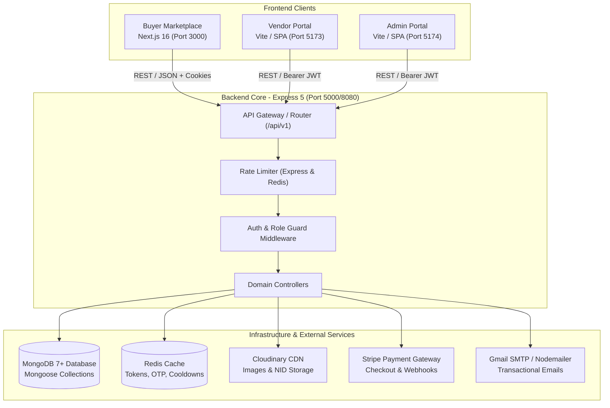

# 01. Project Architecture & System Overview

## 1. Executive Summary & System Overview

**Jus Buy** is a multi-vendor e-commerce platform designed to facilitate transactions among three primary user archetypes:
1. **Buyers (Customers):** Browse product catalogs, filter by categories, manage carts and wishlists, execute checkouts via Stripe, and review purchased products.
2. **Vendors (Merchants):** Apply for vendor status, undergo administrative approval, upload NID identification documents, manage product inventory and pricing, track orders, and monitor sales earnings.
3. **Administrators (Platform Operators):** Review and approve/reject/suspend vendor applications, manage global product categories, monitor platform-wide sales and earnings, and manage user accounts.

The repository is structured as a **Multi-Application Monorepo** comprising four distinct projects:
- `backend/`: Node.js, Express 5, TypeScript, MongoDB (Mongoose), Redis, and Stripe.
- `frontend/`: Buyer-facing web application built with Next.js 16 (App Router), React 19, and Tailwind CSS v4.
- `admin/`: Admin Control Center built with React 19, Vite 8, React Router v8, and Tailwind CSS v4.
- `vendor/`: Vendor Portal built with React 19, Vite 8, React Router v8, and Tailwind CSS v4.

---

## 2. Technical Stack Breakdown

| Layer | Component | Version / Technology | Key Packages & Dependencies |
| :--- | :--- | :--- | :--- |
| **Backend** | Runtime & Server | Node.js (>=20.x), Express v5.2.1 | `express`, `cors`, `helmet`, `cookie-parser`, `compression`, `express-rate-limit` |
| | Language | TypeScript v6.0.3 | `ts-node`, `tsc-alias`, `tsconfig-paths` |
| | Database Engine | MongoDB (ODM: Mongoose v9.10.4) | Multi-document transactions, Sparse indexing, Timestamps |
| | In-Memory Cache | Redis v6.3.0 (`redis`) | Rate limiting, OTP storage & cooldowns, Refresh token store |
| | Authentication | JWT (`jsonwebtoken` v9.0.3), `bcrypt` v6.0.0 | Stateless access tokens + Refresh token rotation stored in Redis |
| | File Storage | Cloudinary v2.11.0, Multer v2.4.0 | Memory storage buffer uploading to Cloudinary folders |
| | Payment Gateway | Stripe v23.1.0 | Stripe Checkout Sessions & Stripe Webhooks |
| | Email Engine | Nodemailer v10.0.15, EJS v7.0.1 | HTML email templates with dynamic OTP generation |
| | Validation | Zod v4.6.5 | Request body, query, and params validation middleware |
| **Frontend (Buyer)** | Framework | Next.js v16.4.0 (App Router), React 19.3.0 | Server & Client Components, Turbopack |
| | State Management | TanStack Query v5.104.1 | Server state caching, optimistic updates, query invalidation |
| | UI & Styling | Tailwind CSS v4, Base UI, Lucide React, Sonner | Radix / Base UI primitives, Sonner toasts |
| | Forms & Validation | React Hook Form v7.89.0, Zod v4.6.7 | `@hookform/resolvers/zod` |
| | HTTP Client | Axios v1.20.0 | Request/Response interceptors, cookie credentials |
| **Admin Dashboard** | Framework | React 19.3.1, Vite v8.3.6, React Router v8.5.2 | Client-Side SPA, Data Loaders, Action Functions |
| | UI & Charts | Tailwind CSS v4, Radix UI, Recharts v3.11.0, Lucide | `@tailwindcss/vite`, Bar charts, Pie/Donut distributions |
| **Vendor Dashboard** | Framework | React 19.3.1, Vite v8.3.6, React Router v8.5.2 | Client-Side SPA, Protected Routing with Vendor Status Guards |
| | UI & Charts | Tailwind CSS v4, Radix UI, Recharts v3.11.0, Sonner | Status badges, NID document previewers, Sonner toasts |

---

## 3. Directory Structure & Key Files

```text
Just-Buy/
├── admin/                         # Admin Dashboard (Vite + React Router v8)
│   ├── src/
│   │   ├── api/                   # API client configuration and domain services
│   │   ├── components/            # UI components, layout, dashboard charts, dialogs
│   │   ├── hooks/                 # useAuth, useDebounce, etc.
│   │   ├── pages/                 # DashboardPage, VendorsPage, BuyersPage, EarningsPage, SettingsPage
│   │   ├── routes/                # Router definition, loaders (dashboard, vendor, buyer), actions
│   │   └── types/                 # TypeScript interfaces for dashboard, vendors, users, earnings
│   ├── package.json
│   └── vite.config.ts
├── backend/                       # REST API Server (Express 5 + Mongoose + Redis)
│   ├── src/
│   │   ├── config/                # Central environment variables & runtime config (index.ts)
│   │   ├── lib/                   # Database connector (mongoose), winston logger, redis client, cloudinary
│   │   ├── middlewares/           # auth, rate-limiter, upload, validateRequest, globalErrorHandler
│   │   ├── modules/v1/            # Feature modules (Modular Monolith)
│   │   │   ├── admin/             # Admin profile and management
│   │   │   ├── auth/              # Registration, login, JWT rotation, OTP, password recovery
│   │   │   ├── buyer/             # Buyer profile and preferences
│   │   │   ├── cart/              # Cart management and item calculations
│   │   │   ├── category/          # Taxonomy, category nesting, slugification
│   │   │   ├── dashboard/         # Aggregated analytics for Admin and Vendor
│   │   │   ├── earnings/          # Payouts, fee deductions, monthly earnings calculations
│   │   │   ├── order/             # Order placement, vendor item grouping, status pipeline
│   │   │   ├── payment/           # Stripe session creation and webhook listeners
│   │   │   ├── product/           # Product CRUD, multi-image upload, inventory, status filters
│   │   │   ├── review/            # Buyer reviews and rating aggregations
│   │   │   ├── user/              # Common User model, roles (ADMIN, VENDOR, BUYER)
│   │   │   ├── vendor/            # Vendor profile, NID uploads, status approvals
│   │   │   ├── verification/      # Email OTP verification & resend logic
│   │   │   └── wishlist/          # Saved products per buyer
│   │   ├── routes/v1/             # Aggregated router index mounting all /api/v1/* routes
│   │   ├── utils/                 # AppError, asyncHandler, sendResponse, JWT helpers, password hashing
│   │   ├── app.ts                 # Express application instantiation, global middlewares
│   │   └── server.ts              # HTTP server listener and graceful shutdown
│   ├── package.json
│   └── tsconfig.json
├── frontend/                      # Buyer-Facing Marketplace (Next.js 16 App Router)
│   ├── src/
│   │   ├── app/                   # App Router pages ((auth), (shop), cart, checkout, profile, etc.)
│   │   ├── components/            # Layout (Header, Footer), shared UI widgets
│   │   ├── features/              # Feature slices (auth, cart, products, orders, checkout)
│   │   ├── hooks/                 # Custom React hooks
│   │   ├── lib/                   # Axios client instance, query client, toast helpers
│   │   └── types/                 # Global domain models and API response types
│   ├── package.json
│   └── next.config.ts
├── vendor/                        # Vendor Control Center (Vite + React Router v8)
│   ├── src/
│   │   ├── api/                   # API client and service layer (auth, vendor, products, orders)
│   │   ├── components/            # Layout (VendorSidebar, VendorHeader), custom inputs
│   │   ├── hooks/                 # useAuth hook with role enforcement
│   │   ├── pages/                 # Dashboard, Products, AddProduct, Orders, Earnings, Settings, VerifyOtp
│   │   ├── routes/                # ProtectedRoute and ApprovedVendorRoute definitions
│   │   └── types/                 # Vendor domain models
│   ├── package.json
│   └── vite.config.ts
└── docs/                          # Architecture & Migration Documentation suite
```

---

## 4. Communication Architecture & Data Flow



### Communication Protocols & Strategy:
1. **REST over HTTP/HTTPS:** All client-to-server interactions use standard RESTful conventions (`GET`, `POST`, `PATCH`, `DELETE`).
2. **State & Rendering:**
   - Buyer App (`frontend/`): Hybrid Server-Side Rendering (SSR) & Client-Side Component rendering via Next.js 16 App Router. TanStack Query manages client-side caching and refetching.
   - Admin & Vendor Portals (`admin/`, `vendor/`): Single Page Applications (SPAs) compiled by Vite. Data loading is orchestrated using React Router Loaders and Axios instances.
3. **Authentication Handshake:**
   - Buyer Frontend relies on HTTP-only cookies (`accessToken`, `refreshToken`) sent with `withCredentials: true`.
   - Admin and Vendor dashboards store the `accessToken` in `localStorage` (`jus_buy_vendor_token` and `jus_buy_admin_token`) and attach it via an `Authorization: Bearer <token>` header in request interceptors.

---

## 5. Environment & Infrastructure Setup

### Required Environment Variables (`backend/.env`)

```ini
# Application Configuration
PORT=5000
NODE_ENV=development
LOG_LEVEL=info

# Database
MONGO_URI=mongodb://localhost:27017/jus-buy

# Redis (Caching, Rate Limiting, OTP)
REDIS_HOST=localhost
REDIS_PORT=6379
REDIS_PASSWORD=
REDIS_USER=default

# URLs & Origins
FRONTEND_URL=http://localhost:3000
CLIENT_URL=http://localhost:3000
WHITELISTED_ORIGINS=http://localhost:3000,http://localhost:5173,http://localhost:5174

# JWT Secrets & Expiry
JWT_ACCESS_SECRET=your_jwt_access_secret_key_minimum_32_characters
JWT_REFRESH_SECRET=your_jwt_refresh_secret_key_minimum_32_characters
ACCESS_TOKEN_EXPIRY=1h
REFRESH_TOKEN_EXPIRY=30d

# SMTP Configuration (Nodemailer)
EMAIL_HOST=smtp.gmail.com
EMAIL_PORT=465
EMAIL_SECURE=true
EMAIL_USER=your_email@gmail.com
EMAIL_PASS=your_gmail_app_password
EMAIL_FROM=no-reply@jusbuy.com

# Cloudinary (Media & NID Documents)
CLOUDINARY_CLOUD_NAME=your_cloud_name
CLOUDINARY_API_KEY=your_api_key
CLOUDINARY_API_SECRET=your_api_secret
IMAGE_MAX_SIZE=5242880

# Stripe Payment
STRIPE_SECRET_KEY=sk_test_...
STRIPE_WEBHOOK_SECRET=whsec_...
STRIPE_CURRENCY=usd
STRIPE_SUCCESS_URL=http://localhost:3000/payment/success
STRIPE_CANCEL_URL=http://localhost:3000/payment/cancel

# Security & Limits
OTP_LENGTH=5
OTP_EXPIRES_IN=300
OTP_RESEND_COOLDOWN=60
OTP_MAX_ATTEMPTS=5
PASSWORD_RESET_EXPIRES_IN=900
LOGIN_MAX_ATTEMPTS=5
LOGIN_RATE_LIMIT_WINDOW=900
LOGIN_LOCKOUT_DURATION=900
BCRYPT_SALT_ROUNDS=12
```

### Local Development Commands

```bash
# 1. Start MongoDB and Redis locally or via Docker
docker run -d -p 27017:27017 --name mongodb mongo:latest
docker run -d -p 6379:6379 --name redis redis:alpine

# 2. Run Backend
cd backend
npm install
npm run dev

# 3. Run Buyer Frontend
cd frontend
npm install
npm run dev

# 4. Run Vendor Portal
cd vendor
npm install
npm run dev

# 5. Run Admin Portal
cd admin
npm install
npm run dev
```
