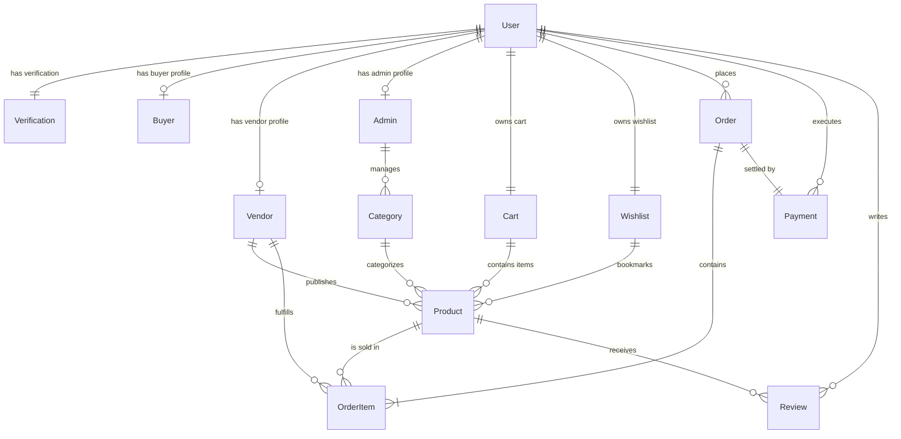

# 02. Database Design & Entity Architecture

## 1. Database Engine Overview

The backend uses **MongoDB** as its primary document database, interfaced via **Mongoose ODM (v9.10.4)**.
- **Transactions:** Multi-document ACID transactions via `mongoose.startSession()` (used heavily during User registration, Buyer/Vendor/Admin profile creation, and Order placement).
- **Indexing:** Standard single-field indexes, compound indexes, unique constraints, and sparse indexes (e.g. `licenceNumber`, `stripeSessionId`).
- **Timestamps:** Automatic `createdAt` and `updatedAt` tracking enabled across all operational collections (`{ timestamps: true, versionKey: false }`).

---

## 2. Collections & Schema Definitions

### 2.1 `users` Collection (`User` Model)
Located at: `backend/src/modules/v1/user/user.model.ts`

| Field | Type | Attributes / Constraints | Description |
| :--- | :--- | :--- | :--- |
| `_id` | `ObjectId` | Primary Key | MongoDB Unique Identifier |
| `name` | `String` | `required: true, trim: true, maxlength: 100` | User's full name |
| `email` | `String` | `required: true, unique: true, lowercase: true, trim: true` | Primary login identity |
| `password` | `String` | `required: true, select: false` | Bcrypt hashed password |
| `status` | `String` | `enum: ["ACTIVE", "BLOCKED"], default: "ACTIVE"` | User account status |
| `verification` | `ObjectId` | `ref: "Verification", required: true` | Reference to verification record |
| `role` | `String` | `enum: ["ADMIN", "VENDOR", "BUYER"], default: "BUYER"` | Role-based authorization |
| `createdAt` | `Date` | Timestamp | Account creation date |
| `updatedAt` | `Date` | Timestamp | Last record modification date |

---

### 2.2 `verifications` Collection (`Verification` Model)
Located at: `backend/src/modules/v1/verification/verification.model.ts`

| Field | Type | Attributes / Constraints | Description |
| :--- | :--- | :--- | :--- |
| `_id` | `ObjectId` | Primary Key | Verification record ID |
| `user` | `ObjectId` | `ref: "User", required: true, unique: true` | Associated User |
| `otp` | `String` | `required: true, select: false` | SHA256 hashed 5-digit OTP |
| `isEmailVerified`| `Boolean` | `default: false` | Whether email is verified |
| `emailVerifiedAt`| `Date` | `default: null` | Verification timestamp |
| `attempts` | `Number` | `default: 0, min: 0` | Failed verification attempts |
| `expiresAt` | `Date` | `required: true` | OTP expiration date (5 min) |

---

### 2.3 `vendors` Collection (`Vendor` Model)
Located at: `backend/src/modules/v1/vendor/vendor.model.ts`

| Field | Type | Attributes / Constraints | Description |
| :--- | :--- | :--- | :--- |
| `_id` | `ObjectId` | Primary Key | Vendor Profile ID |
| `vendor` | `ObjectId` | `ref: "User", required: true, unique: true` | Foreign Key to User |
| `location` | `String` | `trim: true` | Business or store location |
| `licenceNumber` | `String` | `trim: true, unique: true, sparse: true` | Trade license number |
| `profile` | `Object` | Subdocument: `{ publicId, url, width, height }` | Vendor avatar / logo |
| `nidFrontImage` | `Object` | Subdocument: `{ publicId, url, width, height }` | NID front scan (Cloudinary) |
| `nidBackImage` | `Object` | Subdocument: `{ publicId, url, width, height }` | NID back scan (Cloudinary) |
| `status` | `String` | `enum: ["NOT_SUBMITTED", "PENDING", "APPROVED", "REJECTED", "SUSPENDED"], default: "PENDING"` | Administrative review status |

---

### 2.4 `buyers` Collection (`Buyer` Model)
Located at: `backend/src/modules/v1/buyer/buyer.model.ts`

| Field | Type | Attributes / Constraints | Description |
| :--- | :--- | :--- | :--- |
| `_id` | `ObjectId` | Primary Key | Buyer Profile ID |
| `buyer` | `ObjectId` | `ref: "User", required: true, unique: true` | Foreign Key to User |
| `profile` | `Object` | Subdocument: `{ publicId, url, width, height }` | Buyer profile photo |
| `phoneNumber` | `String` | `trim: true, default: ""` | Contact phone number |
| `shippingAddress` | `String` | `trim: true, default: ""` | Default shipping address string |

---

### 2.5 `categories` Collection (`Category` Model)
Located at: `backend/src/modules/v1/category/category.model.ts`

| Field | Type | Attributes / Constraints | Description |
| :--- | :--- | :--- | :--- |
| `_id` | `ObjectId` | Primary Key | Category ID |
| `admin` | `ObjectId` | `ref: "User", required: true, index: true` | Creator Admin |
| `name` | `String` | `required: true, trim: true, maxlength: 100` | Category display title |
| `image` | `Object` | Subdocument: `{ publicId, url, width, height }` | Category banner icon |
| `isActive` | `Boolean` | `default: true, index: true` | Public visibility flag |

---

### 2.6 `products` Collection (`Product` Model)
Located at: `backend/src/modules/v1/product/product.model.ts`

| Field | Type | Attributes / Constraints | Description |
| :--- | :--- | :--- | :--- |
| `_id` | `ObjectId` | Primary Key | Product ID |
| `vendor` | `ObjectId` | `ref: "Vendor", required: true, index: true` | Owner Vendor ID |
| `category` | `ObjectId` | `ref: "Category", required: true, index: true` | Category Taxonomy |
| `name` | `String` | `required: true, trim: true, maxlength: 200` | Product title |
| `description` | `String` | `required: true, trim: true` | Detailed description |
| `brand` | `String` | `trim: true, default: ""` | Manufacturer / Brand |
| `price` | `Number` | `required: true, min: 0` | Regular retail price |
| `stock` | `Number` | `required: true, min: 0, default: 0` | Available stock inventory |
| `sizes` | `[String]` | `enum: ["S", "M", "L", "XL", "XXL"]` | Available apparel sizes |
| `featureImage` | `Object` | Subdocument: `{ publicId, url, width, height }` | Primary product thumbnail |
| `images` | `[Object]` | Array of subdocuments | Secondary gallery photos |
| `salesCount` | `Number` | `default: 0, min: 0` | Total units sold counter |
| `isActive` | `Boolean` | `default: true, index: true` | Active listing toggle |
| `isFeatured` | `Boolean` | `default: false, index: true` | Featured on homepage |

---

### 2.7 `carts` Collection (`Cart` Model)
Located at: `backend/src/modules/v1/cart/cart.model.ts`

| Field | Type | Attributes / Constraints | Description |
| :--- | :--- | :--- | :--- |
| `_id` | `ObjectId` | Primary Key | Cart ID |
| `buyer` | `ObjectId` | `ref: "User", required: true, unique: true` | Cart owner (1 cart per user) |
| `productItems` | `[Object]` | Array of subdocuments: `{ _id, product, quantity, size }` | Cart items |

---

### 2.8 `orders` Collection (`Order` Model)
Located at: `backend/src/modules/v1/order/order.model.ts`

| Field | Type | Attributes / Constraints | Description |
| :--- | :--- | :--- | :--- |
| `_id` | `ObjectId` | Primary Key | Order ID |
| `buyer` | `ObjectId` | `ref: "User", required: true, index: true` | Purchasing Customer |
| `shippingAddress` | `Object` | Subdocument: `{ fullName, phoneNumber, address, city, postalCode, country }` | Delivery destination |
| `productItems` | `[Object]` | Embedded array of items (see below) | Purchased items snapshot |
| `subTotal` | `Number` | `required: true, min: 0` | Gross order total before fees |
| `deliveryCharge` | `Number` | `required: true, min: 0, default: 0` | Delivery fee |
| `totalAmount` | `Number` | `required: true, min: 0` | Net paid by customer |
| `totalCommission`| `Number` | `required: true, min: 0` | Platform aggregate fee (10%) |
| `status` | `String` | `enum: ["PENDING", "CONFIRMED", "PROCESSING", "SHIPPED", "DELIVERED", "CANCELLED"]` | Current order lifecycle status |
| `orderType` | `String` | `enum: ["CASH_ON_DELIVERY", "ONLINE"]` | Payment channel |
| `isPaid` | `Boolean` | `default: false` | Payment settlement status |
| `paidAt` | `Date` | `default: null` | Settlement timestamp |

**Embedded Item Details (`IOrderItem`):**
- `product`: `ObjectId (ref: Product)`
- `vendor`: `ObjectId (ref: Vendor)` -> Key for multi-vendor splitting
- `name`: `String`
- `image`: `String`
- `unitPrice`: `Number`
- `quantity`: `Number`
- `size`: `String`
- `itemSubtotal`: `unitPrice * quantity`
- `commissionRate`: `0.10` (10% standard platform commission)
- `commissionAmount`: `itemSubtotal * 0.10`
- `vendorEarning`: `itemSubtotal - commissionAmount`

---

### 2.9 `payments` Collection (`Payment` Model)
Located at: `backend/src/modules/v1/payment/payment.model.ts`

| Field | Type | Attributes / Constraints | Description |
| :--- | :--- | :--- | :--- |
| `_id` | `ObjectId` | Primary Key | Payment transaction ID |
| `order` | `ObjectId` | `ref: "Order", required: true, unique: true` | Associated Order |
| `buyer` | `ObjectId` | `ref: "User", required: true, index: true` | Paying Buyer |
| `paymentMethod`| `String` | `enum: ["CARD", "CASH_ON_DELIVERY"]` | Method |
| `provider` | `String` | `enum: ["STRIPE", "MANUAL"]` | Gateway provider |
| `amount` | `Number` | `required: true, min: 0` | Settled amount |
| `currency` | `String` | `default: "usd"` | Currency ISO code |
| `status` | `String` | `enum: ["PENDING", "COMPLETED", "FAILED", "REFUNDED"]` | Gateway status |
| `stripeSessionId` | `String`| `unique: true, sparse: true` | Stripe Checkout Session ID |
| `stripePaymentIntentId`| `String`| `sparse: true` | Stripe PaymentIntent ID |
| `paidAt` | `Date` | `default: null` | Gateway webhook verified time |

---

### 2.10 `reviews` Collection (`Review` Model)
Located at: `backend/src/modules/v1/review/review.model.ts`
- **Fields:** `_id`, `product` (FK Product), `buyer` (FK User), `rating` (1-5 int), `comment`.
- **Constraint:** Compound index `{ product: 1, buyer: 1 }` with `{ unique: true }` (one review per product per buyer).

---

### 2.11 `wishlists` Collection (`Wishlist` Model)
Located at: `backend/src/modules/v1/wishlist/wishlist.model.ts`
- **Fields:** `_id`, `buyer` (FK User, unique), `products` (`[ObjectId (ref: Product)]`).

---

## 3. Entity Relationships Diagram (ERD)



---

## 4. Multi-Vendor Isolation & Scoping Logic

1. **Vendor Scoping at the Product Layer:**
   - Every product document enforces `vendor: { type: Schema.Types.ObjectId, ref: "Vendor", required: true }`.
   - In `product.service.ts`:
     ```typescript
     // Updating product strictly scoped to logged-in vendor:
     const product = await Product.findOne({ _id: productId, vendor: vendorId });
     if (!product) throw new AppError(status.NOT_FOUND, "PRODUCT_NOT_FOUND");
     ```
2. **Multi-Vendor Orders:**
   - An order placed by a customer may contain products from **multiple distinct vendors**.
   - Instead of breaking orders into separate child orders per vendor, the platform stores an array of `productItems` inside a single `Order` document, with each item referencing the respective `vendor`.
   - **Vendor Query Scoping:**
     When a vendor fetches `/api/v1/orders/vendor/orders`:
     ```typescript
     // Filters orders containing at least one item belonging to this vendor:
     const orders = await Order.find({ "productItems.vendor": vendorId });
     ```
3. **Earnings & Commission Calculations:**
   - Every `OrderItem` calculates:
     - `commissionRate: 0.10` (10%)
     - `commissionAmount: unitPrice * quantity * 0.10`
     - `vendorEarning: (unitPrice * quantity) - commissionAmount`
   - Vendor Earnings API aggregates `productItems` across orders where `isPaid: true` and `vendor: vendorId`.

---

## 5. Seeders & Migration Status

- **Seeder:** A single administrative seed script exists:
  - File: `backend/src/scripts/seedAdmin.ts`
  - Command: `npm run seed:admin`
  - Function: Seeds a default administrative account using `WHITELISTED_ADMIN_MAILS`.
- **Database Migrations:** No migration tool (such as `migrate-mongo` or Prisma) is implemented. Schema evolution relies entirely on runtime Mongoose schema definitions and auto-created indexes.
- **Indexes Audit:**
  - `User.email` -> Unique Index.
  - `Vendor.vendor` -> Unique Index.
  - `Vendor.licenceNumber` -> Sparse Unique Index.
  - `Review.product + Review.buyer` -> Compound Unique Index.
  - `Payment.order` -> Unique Index.
  - `Payment.stripeSessionId` -> Sparse Unique Index.
