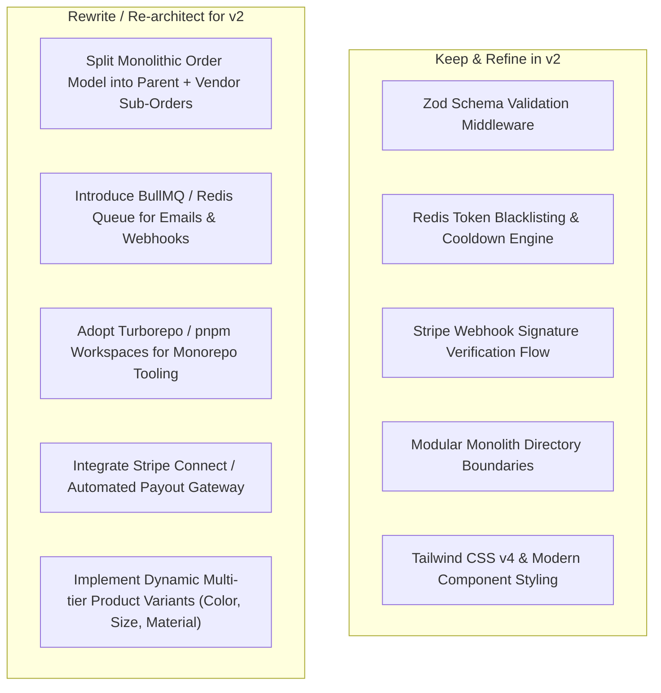

# 07. V2 Migration Recommendations & Technical Roadmap

## 1. Technical Debt & Critical Vulnerabilities in v1

1. **Standalone Build Memory Pressures:**
   - The React 19 + TypeScript 6 compiler inside the Admin SPA frequently hits V8 heap allocation limits (`Fatal process out of memory: Zone`) when executed without explicit `NODE_OPTIONS=--max-old-space-size=4096`.
   - **Fix:** Standardize build scripts to enforce memory ceilings or adopt incremental TS builds (`tsc --build --incremental`).

2. **Single Order Monolithic State:**
   - Multi-vendor items are bundled into a single order without vendor-level delivery status tracking. This makes independent shipping and returns impossible when an order spans multiple stores.

3. **Missing Distributed Task Queue:**
   - Transactional emails and webhook jobs run inline within HTTP handlers. Failure handling is limited to in-memory retry blocks.

4. **Hardcoded Whitelists:**
   - Whitelisted admin emails (`WHITELISTED_ADMIN_MAILS`) are partially hardcoded in config files instead of being stored in administrative database permission tables or environment arrays.

---

## 2. What to Keep vs. What to Rewrite in V2



### 2.1 Components to Preserve:
- **Authentication Core:** The dual access token + Redis-backed refresh token rotation architecture is secure, standards-compliant, and performant.
- **Role Guards & Middleware:** `authenticate`, `authorize`, `requireApprovedVendor`, and `validateRequest` provide clean, declarative protection.
- **Cloudinary Buffer Handler:** Streamlined upload helpers with automatic image dimension metadata.
- **Frontend Design System:** Clean Tailwind CSS v4 styling and Shadcn-inspired UI components.

### 2.2 Components to Overhaul:
- **Order Model Hierarchy:** Redesign `Order` as `Order (Parent)` $\rightarrow$ `SubOrder (Vendor-scoped)` so each vendor manages their own items, tracking numbers, and fulfillment status independently.
- **Variant Engine:** Current products only support a single flat `sizes` array. V2 needs a flexible SKU and multi-dimensional variant schema (`Color`, `Size`, `Storage`, etc.).
- **Payout & Commission Engine:** Implement automated disbursements via Stripe Connect Custom/Express accounts or automated wallet transfers.

---

## 3. Recommended V2 Migration Roadmap

```text
Phase 1: Foundation & Tooling (Weeks 1-2)
├── Migrate repository to Turborepo with pnpm workspaces
├── Standardize shared TypeScript configurations & ESLint rules
└── Implement BullMQ + Redis for asynchronous background tasks

Phase 2: Database & Core Domain Overhaul (Weeks 3-5)
├── Implement Parent-Child Sub-Order schema (Order -> SubOrders)
├── Create flexible Product Variant & Inventory matrix
├── Introduce database migration tooling (migrate-mongo or Prisma)
└── Add database-backed Admin Role-Based Access Control (RBAC)

Phase 3: Automated Payouts & Integrations (Weeks 6-7)
├── Implement Stripe Connect for automated vendor onboarding & payouts
├── Implement real-time WebSockets for order tracking & chat
└── Add coupon, discount, and promotional voucher engine

Phase 4: Client Enhancements & Deployment (Weeks 8-9)
├── Update Buyer, Vendor, and Admin clients for Sub-Order status tracking
├── Set up end-to-end tests (Playwright) and CI/CD pipelines
└── Deploy containerized services with Docker & Kubernetes
```
