# JustBuy — Complete Platform & API Documentation

JustBuy is a full-stack multi-vendor e-commerce platform consisting of four applications in this repository:

| Application | Path | Stack | Purpose |
| :--- | :--- | :--- | :--- |
| **Backend API** | `backend/` | Express 5, TypeScript, MongoDB (Mongoose), Stripe, Cloudinary, Zod | REST API under `/api/v1` |
| **Buyer Storefront** | `frontend/` | Next.js 16 (App Router), React 19, TanStack Query, Tailwind CSS v4, shadcn/ui | Customer shopping, cart, wishlist, checkout, orders, reviews |
| **Vendor Dashboard** | `vendor/` | React, Vite, TypeScript, Tailwind CSS, shadcn/ui | Seller onboarding, product CRUD, order fulfillment, earnings |
| **Admin Dashboard** | `admin/` | React, Vite, TypeScript, Tailwind CSS, shadcn/ui | Platform analytics, buyer/vendor/category/order/earnings oversight |

---

## Documentation Index

1. **[API Catalog](./api-catalog.md)** — Every endpoint in `backend/src/modules/v1/`, grouped by module, with HTTP method, route, auth/role guards, and which app consumes it.
2. **[API Usage Matrix (Used vs. Unused)](./api-usage-matrix.md)** — Exact breakdown of used vs. unused endpoints across `frontend`, `vendor`, and `admin`, plus broken/missing route references and duplicate route aliases.
3. **[Gaps, Improvements & Performance](./gaps-and-improvements.md)** — Missing APIs, security & validation gaps, backend/database performance optimizations, and frontend optimization recommendations.

---

## End-to-End Platform Workflow

```mermaid
flowchart LR
    subgraph Auth ["Authentication & Verification"]
        BReg["Buyer / Vendor Register"] --> OTP["5-Digit Email OTP (/verification/verify-otp)"]
        OTP --> Login["Login (/auth/login) -> JWT Cookies"]
    end

    subgraph VendorFlow ["Vendor Lifecycle"]
        Login --> VStatus{"Admin Approved? (/vendors/:id/status)"}
        VStatus -->|Approved| Prod["Create & Manage Products (/products)"]
    end

    subgraph BuyerFlow ["Buyer Shopping & Order Flow"]
        Prod --> Browse["Browse & Filter Products (/products)"]
        Browse --> CartWish["Cart (/cart) & Wishlist (/wishlist)"]
        CartWish --> Order["Create Order (/orders)"]
        Order -->|COD| CODConfirm["Vendor/Admin Confirms COD"]
        Order -->|Online| Stripe["Stripe Checkout -> Webhook / Verify Session"]
        CODConfirm --> Deliver["Vendor Updates Status -> DELIVERED"]
        Stripe --> Deliver
        Deliver --> Review["Buyer Leaves Review (/reviews)"]
        Deliver --> Earn["Vendor & Admin Earnings Credited (/earnings)"]
    end
```

### Core Role Workflows

1. **Buyer Workflow (`frontend/`)**
   - Register (`POST /auth/register`) → Verify 5-digit OTP (`POST /verification/verify-otp`) → Login (`POST /auth/login`).
   - Browse categories (`GET /categories`) and server-filtered products (`GET /products?page=&limit=&search=&category=&minPrice=&maxPrice=`).
   - Manage wishlist (`GET/POST/DELETE /wishlist`) and cart (`GET/POST/PATCH/DELETE /cart`).
   - Checkout (`POST /orders`) via COD or Stripe; for Stripe, verify payment on `/payment/success` (`GET /payments/verify-session`).
   - Track/cancel orders (`GET /orders/my-orders`, `PATCH /orders/:orderId/cancel`) and submit reviews on delivered items (`POST /reviews`).

2. **Vendor Workflow (`vendor/`)**
   - Register as vendor (`POST /auth/register/vendor`) → Verify OTP → Wait for Admin approval (`APPROVED`).
   - View overview & recent sales (`GET /dashboard/vendor/overview`, `GET /dashboard/vendor/recent-sales`).
   - Create/update/delete products (`POST /products`, `GET/PATCH/DELETE /products/my-products`).
   - Process orders (`GET /orders/vendor/orders`, `PATCH /orders/:orderId/status`, `PATCH /orders/:orderId/confirm-cod-payment`) and track earnings (`GET /earnings/vendor/*`).

3. **Admin Workflow (`admin/`)**
   - Login (`POST /auth/login`) and manage admin profile (`GET/PATCH /admins/me`).
   - Monitor platform metrics (`GET /admin/dashboard/*`).
   - Approve/reject/suspend vendors (`GET/PATCH/DELETE /vendors/*`) and manage buyers (`GET/PATCH/DELETE /buyers/*`).
   - Manage categories (`POST/GET/PATCH/DELETE /categories/*`), orders (`GET /orders/*`), and platform earnings (`GET /earnings/*`).
